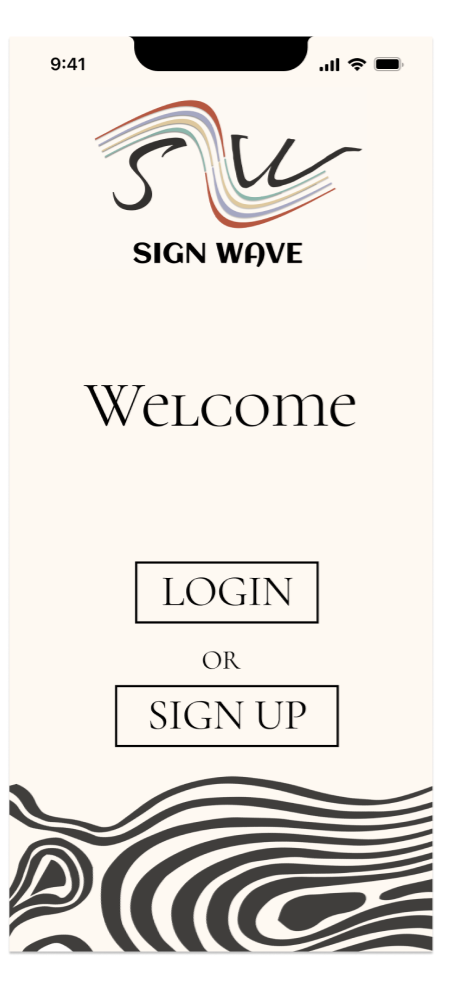
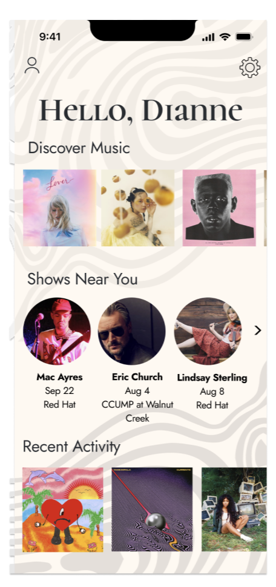
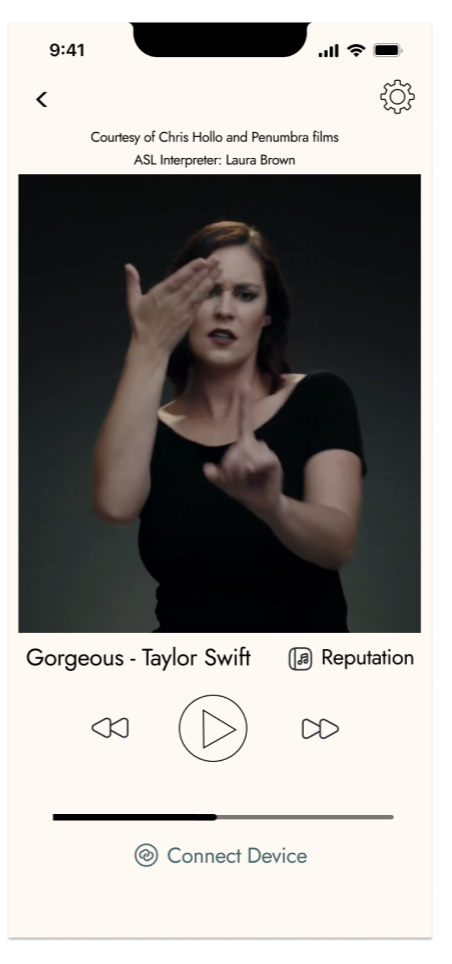

# Sign Wave — Accessible Music App

**UI/UX Design | Figma | NC State University Design Lab**

Sign Wave is an accessible music-listening application prototype for hearing impaired users that explores how deaf and hard-of-hearing users can still experience music through alternate forms of sensory feedback. This project focuses on making music-listening more inclusive and accessible through visual and haptic feedback and accommodations for live music shows.

## Research
Conducted secondary research to explore accessibility barriers in traditional music-listening experiences. Investigated how hard-of-hearing individuals experience music and how visual and haptic feedback could provide alternate ways of experiencing music.

## User Needs
Developed a user persona to identify the ideal user of our application and what their needs would be. We used this persona to guide design decisions and prioritize accessibility.

## Ideation and Wireframing
Created wireframes to map out how the information architecture of our application would look. We developed a login, home screen, and listening screen and the corresponding navigation workflows.

## High-Fidelity Prototype
We used our wireframes to create high-fidelity Figma prototypes that use consistent layouts, typography, logos, and visual hierarchy to create an appealing interface.

### Prototype Link With Design Process: 
https://www.figma.com/proto/recidKHgcPmBS6eTlzz8bf/Sign-Wave-UX-Prototype?node-id=359-6465&utm_source=chatgpt.com

###Prototype Preview:

### Login Screen

### Home Screen

### Music Listening Screen

